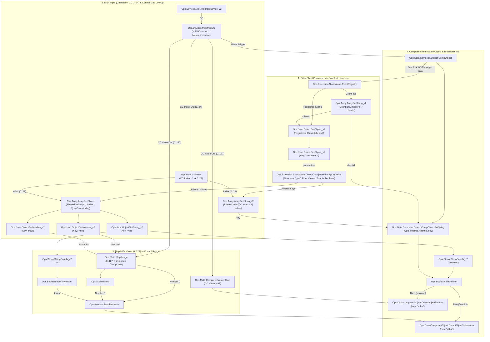

# Visualization Settings Dashboard (`settings_dashboard.html`)

[settings_dashboard.html](file:///Users/jonwood/Github_local_dev/cablesStudio/apps/settings_dashboard.html) is a dynamic real-time control and telemetry interface powered by a local build of **Tweakpane** ([tweakpane.min.js](file:///Users/jonwood/Github_local_dev/cablesStudio/apps/lib/tweakpane.min.js)). It connects to Cables Standalone ([Ops.Extension.Standalone.HttpFileServer](file:///Users/jonwood/Github_local_dev/cablesStudio/ops/Ops.Extension.Standalone.HttpFileServer/Ops.Extension.Standalone.HttpFileServer.js) and [Ops.Extension.Standalone.ClientRegistry](file:///Users/jonwood/Github_local_dev/cablesStudio/ops/Ops.Extension.Standalone.ClientRegistry/Ops.Extension.Standalone.ClientRegistry.js)) or browser `BroadcastChannel` peers to monitor 2D mouse telemetry and dynamically mount parameter UI panes for registered visualization clients.

---

## Features & Workspace Controls

- **Live Input Telemetry Pane**:
  - **2D Coordinate Pad**: Interactive Point 2D pad displaying normalized `(x, y)` coordinates (`0.0` to `1.0`). Dragging the pad emits `mouse_move` telemetry to all connected visualizations.
  - **Real-Time Sparklines**: Multi-line graphs tracking `Mouse X`, `Mouse Y`, and `Scroll dy` (with automatic decay to `0`), alongside a `Last Click` monitor.
- **Dynamic Client Panes (Tabbed or Separated)**:
  - By default, registered clients are mounted as tabs inside the **Registered Visualization Clients** pane.
  - Any client tab can be undocked into its own independent window using the **Separate into Draggable Pane** button (`⧉` in the header or inside the tab) and docked back with **Dock back to Client Tabs** (`⊟`).
  - All panes are freely draggable via their top header bar, support bring-to-front focus, and can be organized using the top bar buttons (**Separate All Panes**, **Dock All to Tabs**, **Reset Positions**, and **Discover Clients**).
- **Dual-Layer Feedback Loop Prevention**:
  1. **Server-Side Exclusion (`broadcastExcept`)**: The WebSocket server broadcasts parameter mutations to all active clients *except* the sending socket.
  2. **Client-Instance Origin ID (`originId`)**: Every client and dashboard generates a unique `originId` and ignores incoming messages matching its own `originId` while setting an `isApplyingRemote` guard when updating Tweakpane bindings.

---

## URL Query Parameters

| Parameter | Default | Description |
| :--- | :--- | :--- |
| `wsHost` | `window.location.host` (or `127.0.0.1:8080`) | WebSocket server `host:port` to connect to (`ws://<wsHost>`). |
| `bc` | `clientRegistry` | Optional `BroadcastChannel` name. Subscribes to `sub-<bc>` and publishes to `pub-<bc>`. |

Example URL:
```text
http://127.0.0.1:8080/settings_dashboard.html?wsHost=127.0.0.1:8080&bc=clientRegistry
```

---

## Example 1: Sending Control Values with Mouse Coordinates

The dashboard listens for `mouse_move`, `mouse_scroll`, and `mouse_click` messages to drive the **Live Input Telemetry** 2D pad and sparklines, and visualization clients listen to the same payloads to drive interactive effects.

### Supported Mouse Telemetry Payloads

#### 1. `mouse_move` (Normalized or Pixel Coordinates)
When `normalized: true` (or when `x` and `y` are between `0.0` and `1.0`), the dashboard maps `x` and `y` directly to the Point 2D pad and sparklines:
```json
{
  "type": "mouse_move",
  "x": 0.64,
  "y": 0.32,
  "normalized": true
}
```
> **Note:** Dragging the 2D Coordinate Pad inside `settings_dashboard.html` also broadcasts this `mouse_move` payload (wrapped in `{ "channel": "clientRegistry", "data": ... }`) so you can test and control visualizations directly from the dashboard.

#### 2. `mouse_scroll` (Scroll Delta)
Updates the `Scroll dy` sparkline on the dashboard and drives scroll-reactive visualizations (such as [js_trassel.html](file:///Users/jonwood/Github_local_dev/cablesStudio/apps/mouse_overlays/js_trassel.html)):
```json
{
  "type": "mouse_scroll",
  "dx": 0,
  "dy": 14.5
}
```

#### 3. `mouse_click` (Mouse Buttons `MB1`–`MB6`)
Updates the `Last Click` telemetry readout and triggers click behaviors in subscribed visualizations:
```json
{
  "type": "mouse_click",
  "button": "MB1",
  "pressed": true,
  "x": 0.64,
  "y": 0.32,
  "normalized": true
}
```

### JavaScript Example: Sending Mouse Coordinates & Control Telemetry

You can send mouse coordinates and control telemetry from a Cables patch, a Node.js script, or a browser page over WebSocket:

```javascript
const ws = new WebSocket("ws://127.0.0.1:8080");

function sendTelemetry(payload) {
  if (ws.readyState === WebSocket.OPEN) {
    ws.send(JSON.stringify({
      channel: "clientRegistry",
      data: payload
    }));
  }
}

// Send normalized 2D mouse coordinates (0.0 - 1.0)
window.addEventListener("mousemove", (e) => {
  sendTelemetry({
    type: "mouse_move",
    x: e.clientX / window.innerWidth,
    y: e.clientY / window.innerHeight,
    normalized: true
  });
});

// Send mouse button press (MB1, MB2, MB3, MB4, MB5, MB6)
window.addEventListener("mousedown", (e) => {
  const buttonMap = { 0: "MB1", 1: "MB3", 2: "MB2", 3: "MB4", 4: "MB5" };
  sendTelemetry({
    type: "mouse_click",
    button: buttonMap[e.button] || "MB1",
    pressed: true,
    x: e.clientX / window.innerWidth,
    y: e.clientY / window.innerHeight,
    normalized: true
  });
});

// Send scroll wheel delta
window.addEventListener("wheel", (e) => {
  sendTelemetry({
    type: "mouse_scroll",
    dx: e.deltaX,
    dy: e.deltaY
  });
});
```

---

## Example 2: Creating a Visualization Client with a Dynamic Pane

Any visualization page (like [p5_magicWand.html](file:///Users/jonwood/Github_local_dev/cablesStudio/apps/mouse_overlays/p5_magicWand.html) or [js_trassel.html](file:///Users/jonwood/Github_local_dev/cablesStudio/apps/mouse_overlays/js_trassel.html)) can automatically generate a custom Tweakpane UI in `settings_dashboard.html` by dispatching a `client:register` manifest.

### Supported Parameter Types in `manifest.parameters`

Parameters are automatically organized into collapsible Tweakpane folders using their `"group"` property:

| `"type"` | Value Type | Supported Properties | Tweakpane Control |
| :--- | :--- | :--- | :--- |
| `"float"` / `"number"` | `Number` | `value`, `min`, `max`, `step`, `group` | Numeric slider + input |
| `"int"` / `"integer"` | `Number` | `value`, `min`, `max`, `step` (defaults to `1`), `group` | Integer slider + input |
| `"color"` | `String` (Hex) | `value` (e.g. `"#ff0055"`), `group` | Color picker |
| `"boolean"` / `"bool"` | `Boolean` | `value` (`true` / `false`), `group` | Checkbox toggle |
| `"string"` | `String` | `value`, optional `options` (`{ "Label": "val" }` or `["a", "b"]`), `group` | Text input or Dropdown select |

### Complete Visualization Client Example

Below is a complete template showing how a visualization client registers its dynamic pane, responds to `client:discover` requests from the dashboard, and applies real-time `client:update` parameter mutations:

```javascript
// 1. Unique instance ID to prevent feedback loops
const ORIGIN_ID = "my-viz-" + Math.random().toString(36).slice(2, 9);

// 2. Local visualization state
const state = {
  particleSize: 12.0,
  maxParticles: 150,
  trailColor: "#ff0055",
  blendMode: "ADD",
  enableGlow: true,
  mouseX: 0.5,
  mouseY: 0.5
};

// 3. Define the Client Registration Manifest
function buildRegistrationPayload() {
  return {
    type: "client:register",
    originId: ORIGIN_ID,
    manifest: {
      clientId: "custom-particle-viz",
      clientType: "p5",
      name: "Custom Particle Viz",
      parameters: {
        particleSize: {
          type: "float",
          value: state.particleSize,
          min: 1.0,
          max: 50.0,
          step: 0.5,
          group: "Rendering"
        },
        maxParticles: {
          type: "int",
          value: state.maxParticles,
          min: 10,
          max: 500,
          step: 10,
          group: "Simulation"
        },
        trailColor: {
          type: "color",
          value: state.trailColor,
          group: "Colors"
        },
        blendMode: {
          type: "string",
          value: state.blendMode,
          options: {
            "Additive": "ADD",
            "Normal": "BLEND",
            "Screen": "SCREEN"
          },
          group: "Rendering"
        },
        enableGlow: {
          type: "boolean",
          value: state.enableGlow,
          group: "Rendering"
        }
      },
      subscriptions: {
        mouse: true,
        keyboard: false,
        stateUpdates: true
      }
    }
  };
}

// 4. Connect to WebSocket Server
const ws = new WebSocket(`ws://${window.location.host || "127.0.0.1:8080"}`);

function sendPayload(payload) {
  if (ws.readyState === WebSocket.OPEN) {
    ws.send(JSON.stringify({
      channel: "clientRegistry",
      data: payload
    }));
  }
}

ws.addEventListener("open", () => {
  // Register dynamic pane immediately on connect
  sendPayload(buildRegistrationPayload());
});

// 5. Handle Incoming Dashboard Updates & Mouse Telemetry
ws.addEventListener("message", (event) => {
  let msg = JSON.parse(event.data);
  if (msg && msg.channel && msg.data) {
    msg = msg.data; // Unwrap server envelope
  }
  if (!msg || msg.originId === ORIGIN_ID) return; // Ignore own echoes

  // Re-announce manifest if the dashboard clicks "Discover Clients"
  if (msg.type === "client:discover") {
    sendPayload(buildRegistrationPayload());
    return;
  }

  // Apply real-time parameter updates from the dynamic pane
  if (msg.type === "client:update" && msg.clientId === "custom-particle-viz") {
    if (msg.key && msg.value !== undefined && msg.key in state) {
      state[msg.key] = msg.value;
    }
    if (msg.parameters) {
      Object.assign(state, msg.parameters);
    }
    return;
  }

  // Handle mouse coordinates (from OS mouse server or Dashboard 2D pad)
  if (msg.type === "mouse_move") {
    state.mouseX = msg.normalized ? msg.x * window.innerWidth : msg.x;
    state.mouseY = msg.normalized ? msg.y * window.innerHeight : msg.y;
  }
});
```

### Bidirectional Updates (`client:update`)

When you adjust a slider, color picker, toggle, or dropdown in `settings_dashboard.html` (whether docked in a tab or separated into a floating draggable pane), the dashboard emits:

```json
{
  "type": "client:update",
  "originId": "dashboard-k8x92m1",
  "clientId": "custom-particle-viz",
  "key": "trailColor",
  "value": "#00f5d4",
  "parameters": {
    "trailColor": "#00f5d4"
  }
}
```

Similarly, if the visualization client mutates one of its own parameters internally (for example, when cycling modes via `MB6`), it can send the same `client:update` message and `settings_dashboard.html` will automatically update the corresponding Tweakpane control in real time without triggering a feedback loop.

---

## Example 3: Controlling Client Panes via MIDI CC (Knobs 1–24, Channel 0) in Cables Ops

You can map physical MIDI controller knobs (**CC 1 through CC 24** on **MIDI Channel 0**) to a registered client's parameters using [Ops.Extension.Standalone.ClientRegistry](file:///Users/jonwood/Github_local_dev/cablesStudio/ops/Ops.Extension.Standalone.ClientRegistry/Ops.Extension.Standalone.ClientRegistry.js), [Ops.Extension.Standalone.ObjectOfObjectsFilterByKeyValue](file:///Users/jonwood/Github_local_dev/cablesStudio/ops/Ops.Extension.Standalone.ObjectOfObjectsFilterByKeyValue/Ops.Extension.Standalone.ObjectOfObjectsFilterByKeyValue.js), and built-in **cables.gl** operators.

### Patch Wiring Overview



### Step-by-Step Patch Setup

1. **Filter Client Properties to Knob-Compatible Types (`"float"`, `"int"`, `"boolean"`)**:
   - Wire `ClientRegistry` (`Client IDs`) ➔ **`Ops.Array.ArrayGetString_v2`** (`Index: 0`) to select the first client's `clientId`.
   - Wire `ClientRegistry` (`Registered Clients`) + `clientId` ➔ **`Ops.Json.ObjectGetObject_v2`** (manifest) ➔ **`Ops.Json.ObjectGetObject_v2`** (`Key: "parameters"`).
   - Connect `parameters` ➔ **`Ops.Extension.Standalone.ObjectOfObjectsFilterByKeyValue`** (`Filter Key: "type"`, `Filter Values: "float,int,boolean"`).
   - This filters out `"color"` properties and outputs **`Filtered Keys`** (e.g. `["starSize", "starDecay", "maxStars", "disperseSpeed"]`) and **`Filtered Values`** (the corresponding control map objects).

2. **Read MIDI CC (Channel 0, Knobs 1–24) & Look Up the Control Map**:
   - Wire **`Ops.Devices.Midi.MidiInputDevice_v2`** (`CC`) ➔ **`Ops.Devices.Midi.MidiCC`** (`MIDI Channel: "1"` for 0-indexed channel `0`, `Normalize: "none"`).
   - Wire `MidiCC` (`CC Index Out`) ➔ **`Ops.Math.Subtract`** (`Number 2: 1`) so Knob `CC 1` maps to index `0`, `CC 2` maps to index `1`, etc.
   - Wire `Filtered Keys` + `Subtract` (`Index`) ➔ **`Ops.Array.ArrayGetString_v2`** to get the target parameter **`key`**.
   - Wire `Filtered Values` + `Subtract` (`Index`) ➔ **`Ops.Array.ArrayGetObject`** to get the target control map object, then extract **`min`** and **`max`** via **`Ops.Json.ObjectGetNumber_v2`** and **`type`** via **`Ops.Json.ObjectGetString_v2`**.

3. **Map the MIDI Value (`0..127`)**:
   - **For `"float"` and `"int"`**: Wire `MidiCC` (`CC Value Out`), `min`, and `max` into **`Ops.Math.MapRange`** (`old min: 0`, `old max: 127`, `Clamp: true`). Pass the result through **`Ops.Math.Round`** and select between float (`0`) and rounded int (`1`) using **`Ops.String.StringEquals_v2`** (`"int"`) ➔ **`Ops.Boolean.BoolToNumber`** ➔ **`Ops.Number.SwitchNumber`**.
   - **For `"boolean"`**: Wire `MidiCC` (`CC Value Out`) ➔ **`Ops.Math.Compare.GreaterThan`** (`63`).

4. **Compose the `client:update` Payload & Send over WebSocket**:
   - Trigger a **`Ops.Data.Compose.Object.CompObject`** chain on MIDI CC change:
     - **`Ops.Data.Compose.Object.CompObjectSetString`** (`Key: "type"`, `String: "client:update"`)
     - **`Ops.Data.Compose.Object.CompObjectSetString`** (`Key: "originId"`, `String: "cables-midi"`)
     - **`Ops.Data.Compose.Object.CompObjectSetString`** (`Key: "clientId"`, `String`: `clientId`)
     - **`Ops.Data.Compose.Object.CompObjectSetString`** (`Key: "key"`, `String`: `key`)
     - Branch via **`Ops.String.StringEquals_v2`** (`"boolean"`) + **`Ops.Boolean.IfTrueThen`** to set `"value"` with **`Ops.Data.Compose.Object.CompObjectSetBool`** (`Then`) or **`Ops.Data.Compose.Object.CompObjectSetNumber`** (`Else`).
   - Wire `CompObject` (`Result`) ➔ **`WS Message Data`** and trigger **`Process Message`** on `Ops.Extension.Standalone.ClientRegistry` (or send via `Ops.Extension.Standalone.HttpFileServer`).


