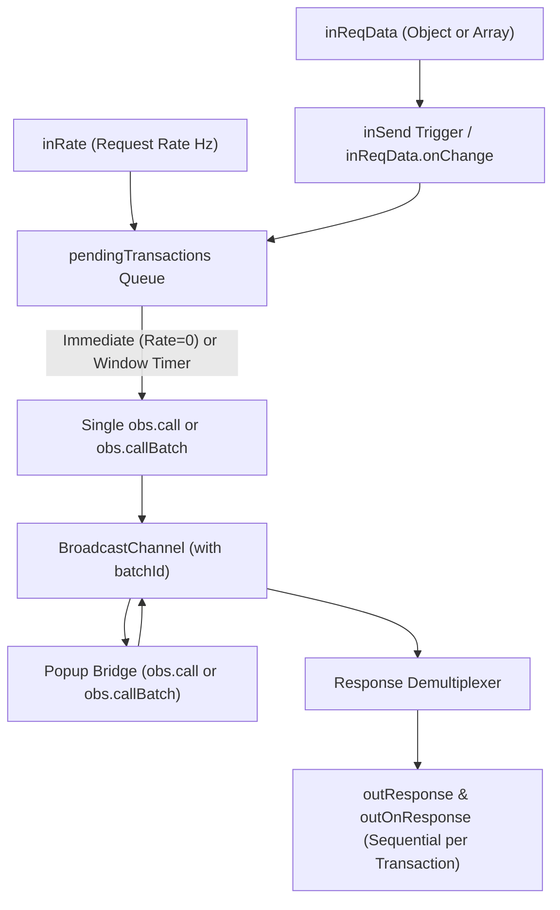

# Plan: Consolidate Request Input & Auto-Batching for ExternalObsConnection

## 1. Executive Summary

This plan outlines the updates for [`Ops.Team.CablesStudio.Externals.ExternalObsConnection.js`](file:///Users/jonwood/Github_local_dev/cablesStudio/ops/Ops.Team.CablesStudio.Externals.ExternalObsConnection/Ops.Team.CablesStudio.Externals.ExternalObsConnection.js). The goal is to:
1. **Completely replace** the legacy `Request Name` (string) and `Request Data` ports with a single unified `Request Data` object input port, modeled after [`Ops.Local.ObsRequest.js`](file:///Users/jonwood/Github_local_dev/cablesStudio/ops/Ops.Extension.Standalone.Obs/Ops.Local.ObsRequest/Ops.Local.ObsRequest.js).
2. **Add automatic batching and rate-limiting** via a configurable rate window (`Request Rate (Hz)`). Multiple requests dispatched within the rate window will be automatically batched into a single OBS WebSocket `RequestBatch` (`callBatch`), reducing socket traffic and avoiding race conditions.
3. **Demultiplex batch responses** so that batched requests transparently resolve and trigger output events for each individual transaction in order.

---

## 2. Architecture Diagram



---

## 3. Detailed Specification

### 3.1 Consolidated Input (`Request Data`)
The legacy separate string port `Request Name` is completely removed. All request configurations are supplied via `inReqData = op.inObject("Request Data", null)`.

#### Supported Input Formats:
1. **Canonical OBS Request Object**:
   ```json
   { "requestType": "GetSceneList", "requestData": {} }
   ```
2. **Flat Parameters Object**:
   ```json
   { "requestType": "SetCurrentProgramScene", "sceneName": "Main Scene" }
   ```
   *(The parser extracts `requestType` and treats remaining keys as `requestData`).*
3. **Direct Batch Array**:
   ```json
   [
     { "requestType": "SetCurrentProgramScene", "requestData": { "sceneName": "Scene A" } },
     { "requestType": "SetInputVolume", "requestData": { "inputName": "Mic", "inputVolumeDb": -6 } }
   ]
   ```
4. **Explicit Batch Object**:
   ```json
   { "requests": [ ... ] }
   ```
5. **Property Name Flexibility**:
   - Accepts either `requestType` or `requestName` inside the object for developer convenience.
6. **Auto-Trigger**:
   - `inReqData.onChange = () => { if (inReqData.get()) inSend.onTriggered(); }`.

#### Parsing Logic:
```javascript
const rawData = inReqData.get();
if (!rawData) {
    outError.set("Request Data is empty.");
    return;
}

let requestId = rawData.requestId || null;
let requests = [];
let isBatch = false;
let originalRequestType = "";

// Check if array or batch container
if (Array.isArray(rawData) || (rawData && Array.isArray(rawData.requests))) {
    isBatch = true;
    originalRequestType = "RequestBatch";
    const rawList = Array.isArray(rawData) ? rawData : rawData.requests;
    requests = rawList.map(req => {
        const type = req.requestType || req.requestName || "";
        const data = req.requestData && typeof req.requestData === "object"
            ? req.requestData
            : sanitizeParams(req, ["requestType", "requestName", "requestId"]);
        return { requestType: type, requestData: data };
    });
} else if (typeof rawData === "object") {
    const type = rawData.requestType || rawData.requestName || "";
    if (!type) {
        outError.set("Missing `requestType` in Request Data.");
        return;
    }
    originalRequestType = type;
    const data = rawData.requestData && typeof rawData.requestData === "object"
        ? rawData.requestData
        : sanitizeParams(rawData, ["requestType", "requestName", "requestId"]);
    
    requests = [{ requestType: type, requestData: data }];
}
```

### 3.2 Request Sanitization & Safety
BroadcastChannel uses the HTML structured clone algorithm, which throws a fatal `DataCloneError` if an object contains circular references, DOM nodes, or functions.
- Incorporate circular-reference-safe JSON normalization from [`Ops.Local.ObsRequest.js`](file:///Users/jonwood/Github_local_dev/cablesStudio/ops/Ops.Extension.Standalone.Obs/Ops.Local.ObsRequest/Ops.Local.ObsRequest.js#L85-L98) to strip circular structures and non-serializable fields before transmitting over `BroadcastChannel`.

### 3.3 Automatic Batching & Rate Limiting
- New input port:
  ```javascript
  inRate = op.inFloat("Request Rate (Hz)", 0)
  ```
- **Execution Modes**:
  - **Immediate Mode (`rate <= 0`)**: Dispatches immediately upon trigger without queuing delay.
  - **Rate-Limited Batch Mode (`rate > 0`)**:
    - Calculates throttling window: `interval = 1000 / rate`.
    - Computes wait time based on `Date.now() - lastSendTime`.
    - Queues requests into `pendingTransactions = []`.
    - Schedules dispatch with `setTimeout(sendBatch, wait)`.
- **Bundling Logic (`sendBatch`)**:
  - If only 1 pending transaction and it is not an explicit batch: sends a single request (`isBatch: false`).
  - If multiple pending transactions OR transaction is an explicit batch: flattens transactions into `flatRequests` array and records `txMapping` (mapping flattened item indices to transaction indices).
  - Sends single message `{ type: "request", isBatch: true, requests: flatRequests, batchId }` over `BroadcastChannel`.

### 3.4 Bridge & Response Demultiplexing
- **Popup Bridge (`templateHtml`) Updates**:
  - Echo back `msg.batchId` in the response message.
  - Support `msg.requests` in `obs.callBatch(requests)`.
- **Parent Response Handler (`setupBroadcastChannel`)**:
  - Use `batchId` to retrieve corresponding transaction batch context.
  - If the response corresponds to a bundled batch of multiple single transactions:
    - Demux batch items back to their source transactions using `txMapping`.
    - For each transaction, set `outReqType`, `outReqStatusResult`, `outSuccess`, `outResponse`, and trigger `outOnResponse.trigger()` sequentially.
  - If the response corresponds to an explicit batch transaction:
    - Set `outResponse` to the full array of results and trigger `outOnResponse.trigger()`.

---

## 4. File Modification Breakdown

### 4.1 [`ExternalObsConnection.js`](file:///Users/jonwood/Github_local_dev/cablesStudio/ops/Ops.Team.CablesStudio.Externals.ExternalObsConnection/Ops.Team.CablesStudio.Externals.ExternalObsConnection.js)
1. **Ports Definition**:
   - Completely remove `inReqName`.
   - Add `inRate = op.inFloat("Request Rate (Hz)", 0)`.
   - Keep `inReqData = op.inObject("Request Data", null)`.
   - Update port group:
     ```javascript
     op.setPortGroup("Request", [inSend, inRate, inReqData]);
     ```
2. **State Management**:
   - Add transaction tracking variables:
     ```javascript
     let pendingTransactions = [];
     let inFlightBatches = new Map();
     let sendTimeout = null;
     let lastSendTime = 0;
     let nextBatchId = 1;
     ```
3. **Trigger Handling (`inSend.onTriggered`)**:
   - Parse `inReqData.get()` according to Section 3.1.
   - Clean circular references.
   - Push to `pendingTransactions` and call `scheduleSend()`.
4. **Scheduling & Dispatch (`scheduleSend`, `sendBatch`)**:
   - Implement rate window calculation.
   - Bundle single/batch requests.
   - Post to `BroadcastChannel`.
5. **Bridge Template (`templateHtml`)**:
   - Ensure `callBatch` and `call` pass `batchId` through to the response message.
6. **Response Demultiplexing**:
   - Demultiplex response arrays by transaction.
   - Emit outputs sequentially.
7. **Cleanup (`op.onDelete`)**:
   - Clear `sendTimeout`.
   - Clear `inFlightBatches` and `pendingTransactions`.

### 4.2 [`ExternalObsConnection.json`](file:///Users/jonwood/Github_local_dev/cablesStudio/ops/Ops.Team.CablesStudio.Externals.ExternalObsConnection/Ops.Team.CablesStudio.Externals.ExternalObsConnection.json)
- Remove `Request Name` from `layout.portsIn`.
- Add `Request Rate (Hz)` (`type: 0`, `subType: "number"`, `group: "Request"`).

### 4.3 [`ExternalObsConnection.md`](file:///Users/jonwood/Github_local_dev/cablesStudio/ops/Ops.Team.CablesStudio.Externals.ExternalObsConnection/Ops.Team.CablesStudio.Externals.ExternalObsConnection.md)
- Remove references to `Request Name`.
- Document `Request Data` input with single and batch examples.
- Document `Request Rate (Hz)` and automatic request bundling.

---

## 5. Verification & Test Plan

| Test Case | Scenario | Expected Outcome |
| :--- | :--- | :--- |
| **TC-1: Consolidated Canonical** | Set `inReqData = { requestType: "GetVersion" }` | Sends `obs.call("GetVersion")`; returns version data; triggers `outOnResponse`. |
| **TC-2: Consolidated Flat Parameters** | Set `inReqData = { requestType: "SetCurrentProgramScene", sceneName: "Main" }` | Extracts `sceneName` into `requestData`; dispatches properly. |
| **TC-3: Automated Batching** | Set `Rate = 5 Hz` (200ms window); trigger 4 requests in rapid succession | Bundles all 4 into a single `callBatch()`; triggers `outOnResponse` 4 times with matching individual results. |
| **TC-4: Direct Batch Array** | Pass `[{ requestType: "GetVersion" }, { requestType: "GetStats" }]` | Explicit batch: executes batch and returns array of results in 1 trigger event. |
| **TC-5: Property Name Flexibility** | Pass `{ requestName: "GetSceneList" }` | Correctly resolves `requestName` as `requestType`. |
| **TC-6: Error / Disconnected** | Send request when popup bridge is closed | Fails immediately with descriptive error string without hanging queue. |
| **TC-7: Circular Reference Safety** | Pass object with self-referencing property | Strips circular link cleanly without crashing `BroadcastChannel`. |
